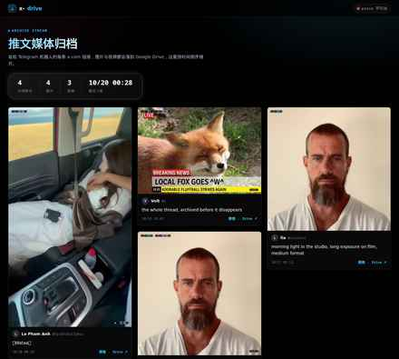

# x-drive

给 Telegram bot 发一条 x.com / twitter.com 链接，它解析推文里的图片和视频，存进 Google Drive，回一条 Drive 文件夹链接。

解析交给 [`wujunwei928/parse-video-py`](https://github.com/wujunwei928/parse-video-py) 的官方镜像；上传交给容器内的 `rclone`。本仓库只有编排和 Telegram 这一层。

```
TG ──▶ bot ──▶ parse:8000 (解析) ──▶ 下载 ──▶ rclone copy ──▶ gdrive:/X-Drive/...
        └────────────────────────────────────────── 回执 ──▶ TG
                                                   │
                                      data/state.json ──▶ web:8080 展示页
```



## 前置

- Docker（含 compose v2）
- 一个 rclone 的 `gdrive` remote（OAuth 已授权，能 `rclone lsd gdrive:`）
- BotFather 给的 bot token

## 步骤

### 1. Docker 权限

当前账号必须在 `docker` 组，或用 ACL 放开 socket：

```bash
sudo usermod -aG docker "$USER"     # 需要重新登录
# 或临时：
sudo chmod 666 /var/run/docker.sock
```

### 2. rclone remote

```bash
rclone config      # n → 新建，名字填 gdrive，type 选 drive，走 OAuth
rclone lsd gdrive: # 能列目录即成功
```

无浏览器的机器：在本地电脑跑 `rclone authorize "drive"`，把输出的 token 粘贴到服务器的 `rclone config` 里。

### 3. 配置

```bash
cp .env.example .env
$EDITOR .env
```

必填两项：

- `TELEGRAM_BOT_TOKEN`
- `RCLONE_CONFIG_HOST`：宿主机 `rclone.conf` 的绝对路径（默认在 `~/.config/rclone/rclone.conf`）

`ALLOWED_USER_IDS` 先留空启动，给 bot 发任意消息，它会回你的 user id；把 id 填进去再重启。

### 4. 启动

```bash
docker compose up -d --build
docker compose ps            # 两个服务都应变 healthy
docker compose logs -f bot
```

### 5. 验证

```bash
docker compose exec bot python -m app.main --check
```

输出 parse 服务与 rclone remote 都 OK 后，在 TG 里发一条带图片或视频的 x 链接。成功回执形如：

```
✅ 已存 Drive · 3 图 1 视频
推文标题…
📁 https://drive.google.com/drive/folders/xxxx
```

Drive 里的结构：

```
X-Drive/<作者uid>_<作者名>/<YYYY-MM>/<推文id>/
    01.jpg  02.jpg  03.mp4  meta.json
```

再发同一条链接会直接复用已有链接，不重复上传。

## 排障

| 现象 | 处理 |
|---|---|
| `parse` 一直 unhealthy | `docker compose logs parse`；该镜像首次启动要装依赖，`start_period` 已给 40s |
| 回执「解析失败：…」 | 推文已删/受保护，或 X 限流；可设 `PARSE_VIDEO_PROXY` 走代理后重启 |
| `rclone 上传失败` | `docker compose exec bot rclone lsd gdrive:` 手测；检查挂载的 `rclone.conf` 与 OAuth 是否过期 |
| 群里发链接没反应 | BotFather 里 `/setprivacy` 设为 Disable，否则群消息里的链接收不到 |
| 回执「未授权」 | 把回执里的 user id 加进 `ALLOWED_USER_IDS` 并 `docker compose up -d` |
| 下载慢/超时 | 调大 `MAX_FILE_MB` 之外无他法；视频直链有时效，必须即到即下 |

## 视频兼容转码

X 的 mp4 常见 `avc1.64001F`（H.264 High profile），部分老播放器、电视盒子、车载屏打不开或只有声音。`bot` 镜像内置 ffmpeg，下载完视频后按 `VIDEO_TRANSCODE` 处理：

| 值 | 行为 |
|---|---|
| `auto`（默认） | ffprobe 读 profile，非 Main/Baseline 才转，已是就跳过 |
| `always` | 一律重编码 |
| `off` | 不转，保留原始字节 |

转码参数 `libx264 -profile:v main -level 4.0 -preset medium -crf 18`，音频 `aac 128k`，带 `+faststart`。实测 8 分 44 秒 720p 素材约 42 秒、22.5MB → 16.0MB，时长与分辨率不变。

转码失败会保留原文件继续上传，只在日志里记一条 warning，不影响入库。

## 用预构建镜像部署（不本机构建）

GitHub Actions 在推 `main` 或 `v*` tag 时构建并推送 `ghcr.io/cloudcranes/x-drive`：

```bash
# 首次需要登录（镜像默认 private；在 Packages 里改 Public 后可跳过）
echo "$GHCR_TOKEN" | docker login ghcr.io -u cloudcranes --password-stdin

cd /opt/x-drive
sed -i 's|^# BOT_IMAGE=.*|BOT_IMAGE=ghcr.io/cloudcranes/x-drive:latest|' .env
docker compose pull && docker compose up -d
```

标签规则：`latest`（main）、`main`、`v1.2.3` / `1.2`（tag）、`sha-xxxxxxx`（每次提交）。

不想用远端镜像时，删掉 `.env` 里的 `BOT_IMAGE` 就会回退到本机 `docker compose up --build`。

## 展示页

`web` 服务把同一份 `data/state.json` 渲染成一页：架构说明、统计卡片、最近入库列表（点行直接打开对应 Drive 文件夹），每 30 秒自动刷新。

**瀑布流布局**：每条推文一张卡片，`column-count` 4→3→2→1 自适应（≥1280 / ≥900 / ≥600 / 手机），卡片 `break-inside:avoid` 不会被拦腰截断；高度随图片比例自然错落。卡片含封面图、图文计数角标、作者头像首字母、`@handle`、标题三行截断、时间，以及「原推 ↗」「Drive ↗」两个入口。

缩略图走同源 `/thumb` 代理（只放行 `*.twimg.com`），避免浏览器直连 `pbs.twimg.com` 时被墙或拿到占位图；未登录同样需要认证。

视觉语言与参考站一致：纯黑底 + 青色光晕 + 细颗粒，标题走渐变扫光，数字用等宽字体，圆角 8px（卡片）/20–28px（统计胶囊），描边统一 `rgba(255,255,255,.10)`。


```bash
# 只看展示（不依赖 bot 运行）
docker compose up -d web
open http://<host>:8080
```

公网暴露时开启登录，在 `.env` 里设 `WEB_AUTH=用户名:密码`，然后 `docker compose up -d web`：

```bash
WEB_AUTH=Alanmaster:xg363034
```

未登录访问返回 401 并渲染专用登录页（`app/login.html`）：账号/密码输入、显示密码、错误提示、加载态，成功后跳看板。页面保留 `WWW-Authenticate: Basic`，因此普通访问仍会触发浏览器原生登录框。账号与密码分别做常量时间比较，密码含 `:` 也能解析。

本地预览（用示例数据，不碰真实 Drive）：

```bash
STATE_PATH=docs/sample-state.json PARSE_BASE_URL=http://127.0.0.1:9 \
  python -m app.web            # 打开 http://127.0.0.1:8080
```

两个接口：`GET /api/tasks`（记录 + 统计 + parse 健康）、`GET /api/health`。

## 已知限制

- **图文混排的推文会丢图**：`parse-video-py` 的 X 解析器只取第一条视频的最高码率 mp4，遇到视频就不再取图片；多视频也只取第一个。需要完整媒体时，得在 `app/main.py` 里加一步 fallback（直接调 Twitter syndication 接口，token 算法见参考仓库），或改上游。
- 依赖 X 的非公开接口，可能被限流或风控；不做登录态抓取。
- 不处理 HLS(`.m3u8`) 直播流；视频转码只做 profile 兼容，不做画质提升（源码率低就是低）。
- 单个 Google 账号上传上限 750GB/日。
- 只处理单条消息里的第一个链接；不做队列持久化，进程重启会丢进行中的任务（已入库的不受影响）。

## 开发

```bash
python -m venv .venv && .venv/bin/pip install -r requirements.txt pytest
.venv/bin/python -m pytest tests -q
```

- `app/core.py`：纯函数层（URL 提取、路径、命名、回执），无 IO
- `app/main.py`：Telegram 编排与 rclone 调用，`tests/test_flow.py` 用 stub 覆盖下载/上传/去重/部分失败
- `app/web.py` + `app/webui.html`：零依赖展示页，`tests/test_web.py` 起真实 HTTP 服务验证接口与 Basic 认证

共 22 个测试，`python -m pytest tests -q` 约 3 秒跑完。
